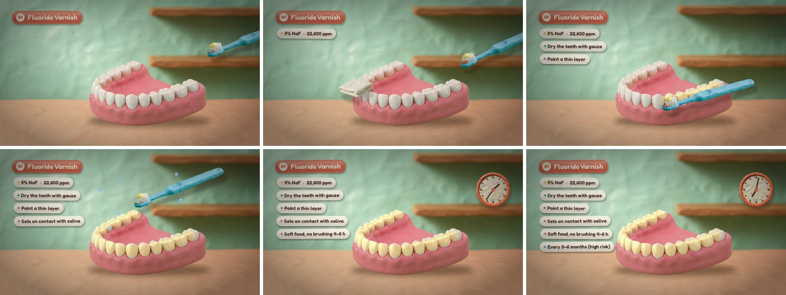
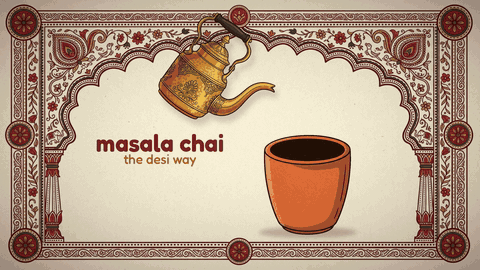
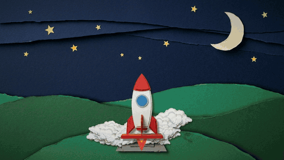
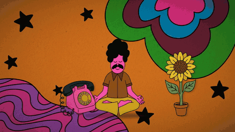
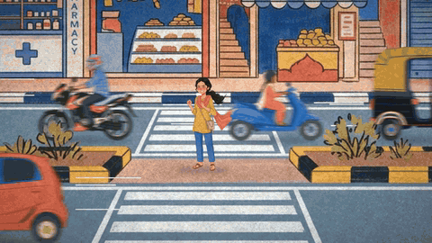

<p align="center">
  
</p>

<p align="center">
  <b>An agent skill for making real motion-graphics videos — where the objects and characters themselves move.</b><br>
  Any style · any topic · synced to voiceover · procedural SFX · one command to render
</p>

<p align="center">
  
  
  
  
</p>

> 🤖 **Agents start here:** [AGENTS.md](AGENTS.md): prerequisites, what to ask first, the step-by-step pipeline, QA gates and rules.

---

## 🎬 See it move

<p align="center">
  
</p>

The brush flies in, the gauze wipes, the brush **paints** and the teeth turn amber behind it, saliva drops fall and splat, the clock spins — all timed to the voiceover words.
▶️ **[Watch the full 22 s sample with sound](docs/media/varnish_sample.mp4)**

<p align="center">
  
</p>

---

## 🎞️ Sample gallery — seven samples, six styles

| 🟠 Claymation · *Fluoride varnish* | 🪔 Desi illustration · *Masala chai* |
|---|---|
|  |  |
| Brush paints, teeth turn amber, saliva drips · [▶️ with sound](docs/media/varnish_sample.mp4) | Kettle pours high, kulhad fills, elaichi drops, steam curls · [▶️ with sound](docs/media/chai_sample.mp4) |
| ✂️ **Paper cut-out · *Rocket launch*** | 🧸 **3D toy · *Seed to sprout*** |
|  |  |
| 3-2-1 slams in, paper smoke billows, camera follows it to the stars · [▶️ with sound](docs/media/rocket_sample.mp4) | Pot slides in, seed bounces, can waters, sun rises, sprout springs up · [▶️ with sound](docs/media/sprout_sample.mp4) |

| 🕺 **70s groovy print + deadpan dark humour · *Good Vibes Only*** | |
|  | Made from **one style reference** (a 70s poster). He meditates, unbothered, while the phone rings (*"it's just your landlord"*), a cloud rains on him (*"it's just your career"*) and lightning fries the sunflower. · [▶️ with sound](docs/media/vibes_sample.mp4) |

| 🚦 **Desi illustration + pose packs · *Zebra crossing*** | |
|  | She waits out the horns on the median, *"Gap mila... bhaago!"*, hurries across with real stepping cycles, then hard cut to the tapri: friends wave, chai pours into kulhads, hi-fi. Hinglish voiceover, VO-led ducked mix. · [▶️ with sound](docs/media/zebra.mp4) |

| 🐸 **Hand-drawn Korean doodle + pose packs · *Paw Playlists* (no VO)** | |
|  | A social-media intro pin brought to life: frog, dog, crow and cat peek in from the edges, the title pops letter by letter, a hamster drops onto it and bounces, a music note bonks from head to head (routed around the type), everyone sings and the button bursts into notes. Whole-frame line boil, ukulele/marimba bed, a sound on every action. · [▶️ with sound](docs/media/pawplay.mp4) |

Every sample: same engine, different asset prompts. Voiceover synced (where there is one), SFX on every action.

---

## ❌ Not this → ✅ This

| Slideshow (what most AI "explainers" do) | vid-shark |
|---|---|
| Static background | Background with slow camera push + stop-motion jitter |
| Text boxes popping up | Objects **perform the action** the voiceover describes |
| Silence or one music loop | A sound on every action: pop, whoosh, squish, plip, tick, pour |
| Captions carry the story | Mute it and it still explains itself |

---

## 🚀 Use it with any agent

Give the repo link to Claude Code, Codex, Cursor, Hark, or any coding agent and say:

```text
Read AGENTS.md and SKILL.md from https://github.com/swapagrawal14/vid-shark
and make me a 30-second motion-graphics video on <topic> in <style> style.
```

The agent writes the script, makes the voiceover, generates every object as a separate cut-out layer, animates them in code, adds SFX and music, and renders a 1080p MP4.

## 🎨 Styles

| 🟠 Claymation | 🪔 Desi flat illustration | ✂️ Paper cut-out | 🧸 3D toy |
|---|---|---|---|
| Plasticine, fingerprint texture, animated "on twos" | Bold Indian illustration, jharokha frames, pour & peel actions | Layered paper, hinged joints, stepped motion | Glossy pastel, bouncy overshoot |

## ⚙️ How it works

```text
script ─▶ voiceover ─▶ style frame ─▶ cut-out layers ─▶ animate in code ─▶ SFX + music ─▶ MP4
            (TTS)       (1 plate)      (1 per object)    (synced to words)   (−16 LUFS)
```

- **Squash & stretch** on every landing, **overshoot pops** on every entrance
- **Paths and arcs** for tools, **pivot rotation** for brushes and limbs
- **Reveal masks** for state changes (teeth turning amber, a glass filling)
- **Particles**: drops, splats, sparkles
- **Preview stills first**, then render the full scene

## 🏃 Run the example

```bash
pip install -r requirements.txt        # needs ffmpeg on PATH
cd examples/varnish
PREVIEW=40,110,185,250 python3 render.py   # quick stills
python3 render.py && python3 audio.py      # → final.mp4

# the other samples render + mix in one go
cd ../chai   && python3 render.py   # desi illustration
cd ../rocket && python3 render.py   # paper cut-out
cd ../sprout && python3 render.py   # 3D toy
```

## 📁 Inside

```text
AGENTS.md             agent quickstart: prereqs, questions, pipeline, QA gates, rules
SKILL.md              the playbook an agent follows: rules, pipeline, styles, limits
engine/motion.py      easing, squash, paste/pivot/shadow, paths, camera, film finish
engine/posepack.py    pose-pack characters (hard cuts, living poses, cycles, anchors) + cut-out QA (alpha, despill, registration)
engine/sheets.py      sprite-sheet slicer, mirror-legs-below-hem, cycle fps, walk-check contact sheet
engine/mix.py         VO-led loudness-aware mix: per-SFX targets, ducking, limiter, verify(), linear loudnorm
engine/chunkrender.py parallel chunked rendering (warm-up frames, concat, audio mux) for short shell timeouts
engine/sfx.py         procedural SFX + music bed + mixer (no sample files needed)
engine/claylib.py     clay-style label plates
examples/common.py    shared scene runner (camera, finish, render loop, audio mix)
examples/varnish/     claymation scene: arch, gauze, brush, reveal mask, saliva, clock
examples/chai/        desi illustration: pour stream, cup fill, falling pods, steam
examples/rocket/      paper cut-out: countdown, smoke particles, camera follow, star streaks
examples/sprout/      3D toy: slide-in, seed bounce, watering, sun rays, growth
examples/vibes/       style + humour from one reference: 70s print, deadpan dark comedy, rain, lightning, char
examples/zebra/       pose-pack characters: zebra crossing (stepping cycles, traffic) → chai tapri, Hinglish VO
examples/pawplay/     hand-drawn doodle intro: five pose-pack animals, title pops, bouncing note, music-led mix (no VO)
examples/tts.py       voiceover via Cartesia (swap in any TTS)
```

## ⚠️ Honest limits

- No frame-by-frame hand-drawn acting or lip-sync. Rigged cut-out characters (limbs, blinks, head tilts) get about 80% of that feel.
- Facts on screen should be checked by a human expert before publishing.

---

<p align="center">Made by <b>Swapnil Agrawal (BDS intern)</b> · <a href="https://github.com/swapagrawal14">@swapagrawal14</a></p>
